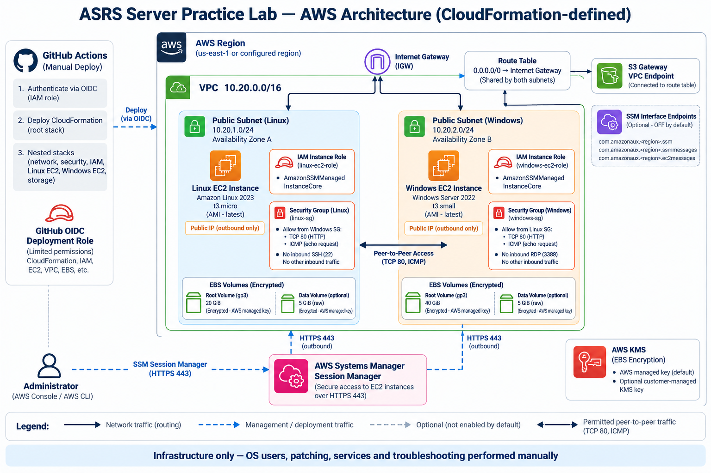

# ASRS Server Practice Lab

A throwaway AWS environment with one **Amazon Linux 2023** server and one **Windows Server 2022**
server, for hands-on practice for an AWS cloud operations / server administration role:
patching, users, permissions, services, scheduled jobs, disks, troubleshooting.

**Infrastructure is automated. Your exercises are not.** CloudFormation builds the network,
security groups, IAM roles and two stock servers. Nothing configures the operating systems:
no user data, no SSM documents, no patching jobs. Every administration task in `labs/` is yours
to do by hand through Systems Manager sessions.



Text version of the diagram, with more detail in [docs/ARCHITECTURE.md](docs/ARCHITECTURE.md):

```
GitHub Actions (manual, approval-gated, OIDC)
        │
        ▼
CloudFormation stack "asrs-lab" ── nested: network, security, iam, linux-ec2, windows-ec2, storage
        │
        ▼
VPC 10.20.0.0/16
 ├─ 10.20.1.0/24  asrs-lab-linux    Amazon Linux 2023, t3.micro  ─┐  ICMP + TCP 80 only,
 └─ 10.20.2.0/24  asrs-lab-windows  Windows Server 2022, t3.small ┘  by security-group reference
No inbound SSH/RDP from anywhere. You connect with SSM Session Manager.
```

## Quick start

| Step | What | Where |
|---|---|---|
| 1 | Push this folder to a new GitHub repository | `docs/DEPLOYMENT.md` §2 |
| 2 | Sign in to AWS through IAM Identity Center | `docs/DEPLOYMENT.md` §1 |
| 3 | Deploy the one-time bootstrap (OIDC trust, roles, artifact bucket) | `docs/DEPLOYMENT.md` §2 |
| 4 | Create GitHub Environments `lab` and `lab-destroy` with yourself as reviewer; set repo variables | `docs/DEPLOYMENT.md` §3 |
| 5 | Set an AWS Budget alert | `docs/COSTS.md` §4 |
| 6 | Run **deploy** in the Actions tab, approve it | `docs/DEPLOYMENT.md` §4 |
| 7 | Connect: `aws ssm start-session --target <instance-id>` | `docs/ACCESS.md` |
| 8 | Work through `labs/` | `labs/README.md` |
| 9 | Run **stop-start → stop** when you finish a session | `docs/COSTS.md` |
| 10 | Run **destroy** when you are done with the lab | `docs/TEARDOWN.md` |

## Repository layout

```
cloudformation/       main.yaml + nested stacks (network, security, iam, linux-ec2, windows-ec2, storage)
bootstrap/            github-oidc-bootstrap.yaml - deploy once, by hand
.github/workflows/    validate.yml, deploy.yml, destroy.yml, stop-start.yml
scripts/              security_checks.py - lab guardrails used by validate.yml
labs/                 25 exercises (10 Linux, 10 Windows, 5 AWS)
labs/solutions/       full solutions - attempt the exercise first
docs/                 ARCHITECTURE, DEPLOYMENT, ACCESS, COSTS, TEARDOWN, INTERVIEW-PREP; images/ holds the diagram
PROJECT_PLAN.md       phases, manual setup, acceptance checklist
```

## Workflows

| Workflow | Trigger | AWS access | Gate |
|---|---|---|---|
| `validate.yml` | push, pull request, manual | none | none (static checks only) |
| `deploy.yml` | manual | `asrs-lab-github-deploy` via OIDC | `lab` environment approval |
| `destroy.yml` | manual | `asrs-lab-github-deploy` via OIDC | typed stack name + `lab-destroy` approval |
| `stop-start.yml` | manual | `asrs-lab-github-operator` via OIDC (stop/start tagged instances only) | none |

Nothing deploys on push. There are no access keys anywhere.

## Run the checks locally

```bash
python3 -m venv .venv && . .venv/bin/activate
pip install cfn-lint checkov pyyaml
cfn-lint                                   # uses .cfnlintrc.yaml
python3 scripts/security_checks.py         # no public ingress, encrypted EBS, IMDSv2, no OS automation
checkov -d . --framework cloudformation github_actions --skip-check CKV_GHA_7 --quiet --compact
```

Static checks passing does **not** mean the stack deploys. Only a real run of `deploy.yml`
proves that (see `PROJECT_PLAN.md`, phase 8).

## Cost in one line

About **USD 0.06/hour while both servers run** plus about **USD 5.60/month for disks** whether or
not they run (us-east-1, defaults). Stop the servers after every session. Details: `docs/COSTS.md`.
